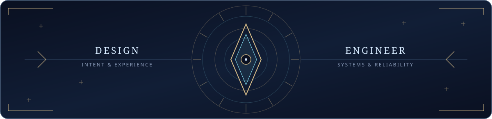
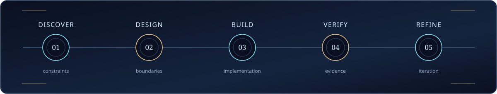

<!--
  TheDEvorger · Engineering showroom
  Ałek’ryŧhæ is intentionally spelled with its original typography.
  The original calligraphic wordmark is Alekrythae.png and MUST be preserved unchanged.
  This is a portfolio introduction, not an audited security declaration.
  No specific project is featured; the projects change, the professional identity endures.
-->

<div align="center">


<!-- Do not replace the original wordmark with a simplified SVG or font. -->

# 🌙 TheDEvorger of Ałek’ryŧhæ 💠

### Ayberk Erdem

**Mechatronics Engineer** &nbsp;·&nbsp; **Software Developer** &nbsp;·&nbsp; **Systems-Oriented Builder**

*Engineering discipline. Thoughtful software. Distinctive design.*

Building across **desktop**, **web**, and **mobile**, with a growing emphasis on
**C# / .NET**, **JavaScript / TypeScript**, and **Flutter / Dart**.

**Open to international opportunities and meaningful collaborations.**

<br />

[**Explore Repositories**](https://github.com/TheDEvorger?tab=repositories)
&nbsp;&nbsp;·&nbsp;&nbsp;
[**Engineering Profile**](#engineering-profile)
&nbsp;&nbsp;·&nbsp;&nbsp;
[**Technical Landscape**](#technical-landscape)
&nbsp;&nbsp;·&nbsp;&nbsp;
[**Connect**](#connect)

<br />

`Software Architecture` &nbsp; `Desktop Systems` &nbsp; `Interface Engineering` &nbsp; `Local-First Thinking`

<picture>
  <source media="(prefers-color-scheme: light)" srcset="assets/showroom/rule-light.svg" />
  
</picture>

</div>

## Welcome

I approach software with the perspective of a **mechatronics engineer**:
understand the system, identify its boundaries, consider its failure modes,
and make the resulting experience understandable for the person using it.

My background includes **industrial automation**, control systems, commissioning,
and practical troubleshooting. My software interests extend into application development,
visual interfaces, local data, modular design, cross-platform tools, and the craft of
turning an idea into a dependable product.

This profile is my **engineering showroom**. It communicates the way I think, design,
learn, and build. It is deliberately **not a fixed catalogue of named projects**.
The public repositories are the living record of the actual work, and they will evolve.

> **Good engineering should be visible in the behavior of a system, not merely claimed in its description.**

<div align="center">

<picture>
  <source media="(prefers-color-scheme: light)" srcset="assets/showroom/compass-light.svg" />
  
</picture>

</div>

<a id="engineering-profile"></a>
## Engineering Profile

<table>
<tr>
<td width="50%" valign="top"><h3>01 · Software Engineering</h3>
<p>Designing application behavior, boundaries, data flow, and maintainable systems.</p>
<ul><li>C# and .NET application development</li><li>Separation of interface and application logic</li><li>Validation and failure-aware workflows</li><li>File handling and persistence</li><li>Maintainability and compatibility thinking</li></ul>
</td>
<td width="50%" valign="top"><h3>02 · Interface Engineering</h3>
<p>Building visual experiences that remain coherent and usable under real conditions.</p>
<ul><li>HTML, CSS, JavaScript and TypeScript</li><li>Responsive layouts and interaction states</li><li>Windows and embedded-web interfaces</li><li>Keyboard-oriented workflows</li><li>Typography, visual hierarchy, and polish</li></ul>
</td></tr>
<tr>
<td width="50%" valign="top"><h3>03 · Data &amp; Systems</h3>
<p>Thinking about ownership, structure, recoverability, and correctness.</p>
<ul><li>SQLite and structured local storage</li><li>JSON and well-defined data contracts</li><li>State transitions and data lifecycles</li><li>User-controlled project files</li><li>Imports, exports, migrations, and backups</li></ul>
</td>
<td width="50%" valign="top"><h3>04 · Continuous Growth</h3>
<p>Extending an engineering foundation into new software domains.</p>
<ul><li>Dart and Flutter development</li><li>Desktop, mobile, and web perspectives</li><li>Deeper architecture and testing skills</li><li>Product design and accessibility</li><li>International engineering collaboration</li></ul>
</td></tr>
</table>

### What I bring to software

| Engineering foundation | Perspective it contributes |
| :--- | :--- |
| **Mechatronics** | A whole-system view, not just individual screens or functions |
| **Industrial automation** | Awareness of state, inputs, outputs, timing, and failure behavior |
| **Commissioning & troubleshooting** | Reproduction, measurement, verification, and structured diagnosis |
| **Application development** | Designing workflows, components, persistence, and user-facing capabilities |
| **Visual design** | Strong product identity without compromising clarity or usability |
| **Independent learning** | Iterating through real implementation, evaluation, and revision |

My experience is not identical across every technology on this page. Some tools are part
of established practical experience; others are areas of active development. Listing a
technology is **not** a claim of certification, specialization, or seniority in that tool.

---

<a id="technical-landscape"></a>
## Technical Landscape

I work across disciplines that often meet inside the same application. The intent is
to choose tools that fit a problem, not to build every problem around the same tools.

### Languages & Markup

| Technology | Primary context |
| :--- | :--- |
| **C#** | Desktop application logic, integration, structured implementation |
| **JavaScript** | Web behavior, frontend interaction, asynchronous workflows |
| **TypeScript** | Typed frontend/application code and explicit contracts |
| **Dart** | Language and application development with Flutter |
| **SQL** | Structured queries and relational persistence concepts |
| **HTML** | Document structure and accessible interface semantics |
| **CSS** | Layout, responsiveness, animation, visual systems |
| **JSON** | Configuration, serialization, structured data interchange |

### Platforms & Frameworks

| Area | Technologies and interests |
| :--- | :--- |
| **Windows desktop** | .NET, native integration, Windows APIs, application lifecycles |
| **Hybrid interfaces** | Microsoft Edge WebView2, native/web boundaries |
| **Frontend** | React, component-driven interfaces, browser platform APIs |
| **Cross-platform** | Flutter and Dart, with mobile development as an active learning area |
| **Persistence** | SQLite, local filesystem, controlled import/export paths |
| **Workflow** | Git, GitHub, VS Code, Visual Studio, debugging, technical documentation |
| **Engineering systems** | PLC, SCADA, field integration, industrial communication fundamentals |

### My technical priorities

- Clear ownership of state and responsibilities.
- Explicit boundaries between UI, application logic, persistence, and platform services.
- Data formats that are understandable and maintainable.
- Error handling designed before the first serious failure.
- Performance budgets appropriate to the actual application.
- Visual polish supported by accessibility and responsive behavior.
- A practical testing strategy, proportional to the risk of change.
- Honest release notes, dependency management, and documentation.

### Technology is a means, not the identity

Frameworks will change. Tools will improve. My aim is to understand the underlying
principles well enough to adapt without rebuilding my entire problem-solving approach.

What matters most is the relationship between **problem**, **constraint**, **design choice**,
**implementation**, and **evidence that it works**.

---

## The Ałek’ryŧhæ Identity

**Ałek’ryŧhæ** is the creative and technical identity associated with my broader
software work. Its calligraphic logo is deliberately preserved at the top of this profile.
The name is part of the identity; it should not be replaced with a simplified spelling
or rendered in a generic font as a substitute for the original artwork.

This identity is broader than any single product, framework, package format, or
repository. Its direction can change as my capabilities and interests develop.

The visual language draws on deep midnight blue, moonlit silver, fine ornamental
lines, deliberate symmetry, and a restrained fantastical atmosphere. That visual
direction should support the information rather than turn the README into a hard-to-read poster.

### Design vocabulary

| Element | Intent |
| :--- | :--- |
| **Calligraphy** | Keep the distinctive identity intact |
| **Night and moonlight** | A recognizable, coherent visual signature |
| **Fine ornament** | Add character without burying content |
| **Readable typography** | Let technical material remain usable |
| **Purposeful whitespace** | Direct attention toward important information |
| **Consistent hierarchy** | Make a lengthy profile easy to navigate |
| **Measured contrast** | Work in both light and dark GitHub themes where practical |
| **Calm motion** | Prefer stability and accessibility over distracting effects |

### The rules of this identity

1. The original `Alekrythae.png` artwork stays untouched.
2. The spelling **Ałek’ryŧhæ** remains exact, including its diacritics and punctuation.
3. Profile artwork must not impersonate, replace, or simplify that original wordmark.
4. Software content must remain truthful and understandable without decorative graphics.
5. Future work may appear in the repositories without forcing a redesign of the profile.
6. The presentation should grow in quality, not in dependency on outside services.

---

## Engineering Method

A disciplined process can be useful without becoming rigid. I prefer to establish the
purpose of the work, identify constraints, design the smallest sound structure, and
verify behavior before enlarging scope.

<div align="center">
<picture>
  <source media="(prefers-color-scheme: light)" srcset="assets/showroom/workflow-light.svg" />
  
</picture>
</div>

### Discover

- Define the user's real task and expected outcome.
- Separate requirements from attractive but unnecessary features.
- Record platform limitations and environmental assumptions.
- Identify data that must persist and data that may be discarded.
- Clarify what failure means for the person using the tool.

### Design

- Draw the relevant component and responsibility boundaries.
- Decide where state is created, changed, stored, and destroyed.
- Define contracts and validation before connecting systems.
- Think about recovery and migration while changes are still inexpensive.
- Reduce the number of implicit assumptions between components.

### Build

- Prefer small, testable vertical slices.
- Keep OS-dependent behavior behind well-defined interfaces where useful.
- Avoid copying shared behavior into unrelated parts of the system.
- Use types and naming to convey constraints and intent.
- Keep the interface responsive and errors comprehensible.

### Verify

- Test representative, boundary, and failure scenarios.
- Reproduce defects rather than patching symptoms blindly.
- Check persistence and update behavior, not only the happy path.
- Exercise keyboard and resized-window interactions.
- Compare actual results to written expectations.

### Refine

- Remove incidental complexity when it no longer serves a purpose.
- Improve documentation as implementation understanding changes.
- Revisit performance bottlenecks with measurements.
- Check whether abstractions have become more complicated than the problem.
- Preserve compatibility when changes affect existing user data.

### The standard I aim for

A successful demonstration is not the same as a reliable release. Software should
continue behaving predictably when a user changes the window size, imports unusual
data, interrupts an operation, or returns after a new version is installed.

---

## A General Architecture Lens

The following is an **illustrative model**, not the disclosed implementation of a
specific repository. Real applications can be simpler or more complex depending on need.

```text
                  USER EXPERIENCE
                         │
           ┌─────────────┴─────────────┐
           │    Interface & Input      │
           │  UI · State · Feedback    │
           └─────────────┬─────────────┘
                         │
           ┌─────────────▼─────────────┐
           │    Application Layer      │
           │  Actions · Workflows      │
           └─────┬───────────────┬─────┘
                 │               │
        ┌────────▼────────┐ ┌────▼──────────────┐
        │ Domain & Rules  │ │ Platform Services │
        │ Models · Logic  │ │ Files · Windows   │
        └────────┬────────┘ └────┬──────────────┘
                 │               │
           ┌─────▼───────────────▼─────┐
           │     Persistence Layer     │
           │ SQLite · JSON · Files     │
           └─────────────┬─────────────┘
                         │
                USER-CONTROLLED DATA
```

The key question is not whether every application has all these boxes. It is
whether the responsibilities that **do** exist have boundaries that make change safer.

### Decisions that shape this model

| Decision | Question I ask |
| :--- | :--- |
| **UI ↔ logic** | Can interaction evolve without rewriting core behavior? |
| **Logic ↔ storage** | Does a database choice dictate the entire product design? |
| **App ↔ operating system** | Which privileged capabilities are exposed and why? |
| **Runtime ↔ user data** | Will an update affect irreplaceable personal content? |
| **Modules ↔ modules** | Can a change be localized, understood, and verified? |
| **Version ↔ compatibility** | What happens to content created by earlier builds? |
| **Error ↔ user** | Does a failure clearly explain what is safe to do next? |
| **Visuals ↔ performance** | Does polish help the experience at an acceptable cost? |

---

## Working Principles

<table>
<tr>
<td width="50%" valign="top"><h3>Ⅰ · Clarity before complexity</h3><p>Prefer understandable responsibilities and explicit contracts over architecture chosen merely to look impressive.</p></td>
<td width="50%" valign="top"><h3>Ⅱ · User data deserves care</h3><p>Design storage, migration, backup, and deletion with the understanding that the user's work is more important than the application's internal convenience.</p></td>
</tr>
<tr>
<td width="50%" valign="top"><h3>Ⅲ · Security needs evidence</h3><p>Input validation, permissions, dependency review, and boundaries matter more than claims that a program is simply “secure.”</p></td>
<td width="50%" valign="top"><h3>Ⅳ · Interfaces should communicate</h3><p>A visual language needs hierarchy, feedback, accessible contrast, and coherent interaction before decoration.</p></td>
</tr>
<tr>
<td width="50%" valign="top"><h3>Ⅴ · Test what can break</h3><p>Invest effort in the paths where failures can affect data, availability, or a person's trust in the software.</p></td>
<td width="50%" valign="top"><h3>Ⅵ · Explain the release</h3><p>Distinguish what shipped from what is experimental, planned, unsupported, or intentionally limited.</p></td>
</tr>
</table>

---

## Notes from the Engineering Workbench

These sections are deliberately expandable. The overview above remains easy to scan,
while visitors who care about technical decision-making can read further.

<details>
<summary><strong>01 · Software architecture and responsibility boundaries</strong></summary>

### Start from a requirement, not a pattern

A pattern becomes useful when it solves a real source of complexity. I prefer to map
what must happen before adding layers, inheritance, messages, factories, or containers.

Questions worth answering:

- Which component owns each piece of mutable state?
- What data passes across the boundary and in what form?
- Can the behavior be tested without constructing an entire graphical environment?
- What happens when the dependent subsystem is unavailable?
- Which pieces should remain independent of the operating system?
- How many different places must change to add one capability?
- Is an abstraction reducing coupling or only hiding it?

### Keep contracts explicit

Types, validation rules, command names, schema versions, and error results all
communicate intent. Ambiguous contracts create fragile integration even when
individual modules work correctly.

### Fit the architecture to the size of the task

A small utility may be best served by a straightforward structure. A larger
application may need clearer separation of interface, state, domain rules,
and platform services. Neither extreme is a universal standard.

**Principle:** Complexity should pay rent in clarity, safety, or adaptability.

</details>

<details>
<summary><strong>02 · Desktop application behavior and native integration</strong></summary>

A desktop application is more than its primary window. Its lifecycle and
relationship with the operating system affect how users experience reliability.

Areas I consider:

- Startup and shutdown behavior.
- Minimum and maximum window sizes.
- Remembering window state appropriately.
- Keyboard focus and navigation.
- File associations and expected user permissions.
- Display scaling and different monitor arrangements.
- Asynchronous tasks that must not freeze the interface.
- Error reporting during platform-dependent operations.
- Cleanup of resources when a window or process closes.
- Clear distinctions between portable data and machine-specific preferences.

### Native and web views

Hybrid desktop applications can combine native operating-system capabilities
with expressive HTML/CSS/JavaScript interfaces.

The boundary between those layers must be treated as a real design decision.
Exposing a bridge into privileged native functionality requires validation,
minimal capabilities, and careful handling of untrusted content.

**Principle:** Convenience of integration should not dissolve responsibility boundaries.

</details>

<details>
<summary><strong>03 · State management, commands and application behavior</strong></summary>

User interactions create sequences of state transitions. A system becomes
harder to maintain when the same state is changed in several unrelated places.

Useful questions include:

- What is the single reliable source for this state?
- Which transitions are legal, and which must be rejected?
- How are UI feedback and persisted state kept consistent?
- Can a command be retried safely?
- What happens if an operation completes only partially?
- Are long-running operations cancellable?
- How are errors returned to the component able to explain them?

### Event-driven thinking

Industrial control work reinforces the need to understand event ordering,
state transitions, and how a system reacts to new information. That perspective
can be applied to desktop and web application workflows without pretending
that all software resembles a PLC.

**Principle:** Predictable behavior begins with predictable state ownership.

</details>

<details>
<summary><strong>04 · Local-first data, persistence and ownership</strong></summary>

Local-first design can be appropriate for tools that manage personal content,
media, structured projects, or offline workflows. It is a choice, not a promise
that every future application will avoid network services.

### Separate the concerns

- Application assets are not user-created documents.
- Cache data is not the canonical source of truth.
- Settings are not the same as domain data.
- A database schema is not the public format of a user-facing export.
- Temporary files are not a reliable backup strategy.

### Storage options

SQLite can be suitable when transactional updates and structured queries matter.
JSON or plain files may be more appropriate for simpler, inspectable data.
The implementation should account for the expected workload and recovery needs.

### Important failure cases

- Interrupted writes and partial operations.
- Unexpected shutdowns.
- Storage permissions and unavailable directories.
- Corrupted or incompatible input.
- Duplicate names, Unicode text, and long paths.
- Migration from an older data representation.
- Import/export failures and accidental overwrites.

**Principle:** User content should be treated as an asset, not an implementation detail.

</details>

<details>
<summary><strong>05 · Security-conscious development</strong></summary>

Security is a continuing engineering responsibility. A profile README cannot
prove the absence of vulnerabilities, and visual badges should not suggest an
audit that never happened.

### Threat-aware habits

- Distinguish trusted application code from untrusted input.
- Validate file paths and reject traversal outside an intended root.
- Avoid following unsafe links or filesystem redirections without controls.
- Define what a process or plugin is allowed to access.
- Avoid exposing more native functionality than an interface needs.
- Keep credentials, signing keys, secrets, and tokens out of published materials.
- Review dependencies and important upstream changes.
- Limit the effects of malformed input and partial failures.
- Respect licensing and ownership of third-party assets.
- Provide a responsible route for reporting sensitive findings.

### A claim must match evidence

A security policy establishes communication. A passing test is evidence for
that test's scope. Neither one justifies claiming a system is invulnerable.

Security design also depends on the actual privilege model, threat assumptions,
deployment environment, and verification performed on the implementation.

**Principle:** Define, constrain, test, document, and revisit the trust boundaries.

</details>

<details>
<summary><strong>06 · Testing, debugging and technical verification</strong></summary>

Testing is most valuable when it protects behavior that matters to the user.

### Test categories I consider

- Unit checks for business rules and transformations.
- Integration checks across persistence or platform boundaries.
- Compatibility checks for previous data or file formats.
- Regression checks for previously fixed defects.
- Failure-path checks for malformed data and interrupted operations.
- UI checks for keyboard, scaling, and navigation behavior.
- Performance measurements for realistic workloads.
- Manual exploratory testing when automated checks cannot capture the risk.

### Practical debugging

1. Reproduce the symptom as precisely as possible.
2. Isolate what changed and which boundary is involved.
3. Reduce the reproduction to the smallest useful case.
4. Form a hypothesis that can be disproved.
5. Inspect logs, state, files, or measurements as appropriate.
6. Verify the correction against the original reproduction.
7. Check nearby behavior for regressions.
8. Document why the change was made.

Tests should support confidence in defined behavior, not function as decorative numbers.

**Principle:** Prefer verifiable understanding to unexplained success.

</details>

<details>
<summary><strong>07 · UX, accessibility and distinct visual identity</strong></summary>

A polished interface is not only a screenshot. It is an interaction system
that remains understandable while users perform real tasks.

### Interaction quality

- Layouts respond gracefully to different window sizes.
- Focus and keyboard behavior are predictable.
- Feedback shows whether a task has started, succeeded, or failed.
- Navigation avoids unnecessary ambiguity.
- Typography is readable at realistic scaling levels.
- Contrast and emphasis support information hierarchy.
- Motion communicates changes without obstructing tasks.
- Error messages explain what happened and what can be done next.

### Visual identity with restraint

Ornament, atmosphere, color, and animation can make software memorable.
The challenge is ensuring they remain subordinate to usability.
A distinctive brand is strongest when consistent details reinforce each other.

I am interested in combining expressive design with practical desktop and web
implementation, while learning to improve the accessibility of the result.

**Principle:** A beautiful interface should still behave like a reliable tool.

</details>

<details>
<summary><strong>08 · Performance, responsiveness and resource budgets</strong></summary>

Performance is not only a benchmark result. It is how quickly a user can
interact, whether operations block each other, and how an application behaves
on the equipment people actually own.

### Watch the cost of

- Frequent UI re-rendering.
- Unnecessary filesystem scans.
- Unbounded queues and accumulated background work.
- Database operations performed on critical UI paths.
- Large media files retained longer than needed.
- Excessive visual effects or animation.
- Heavy startup dependencies.
- Work repeated when a result could be reused safely.

### Measure before optimizing

A measured bottleneck is a stronger guide than a fashionable optimization rule.
The relevant budget depends on device capability, workload, and user expectations.

**Principle:** Make performance decisions proportional to observable costs.

</details>

<details>
<summary><strong>09 · Versions, data migrations and compatibility</strong></summary>

Software changes over time; user-created content may live much longer than
an individual program version.

### Useful compatibility questions

- Does a new version understand older files?
- Is the data format versioned or self-describing?
- Can an incompatible input fail without being overwritten?
- What happens if a migration stops halfway through?
- Is the previous state preserved when necessary?
- Can the user identify the required software version?
- Do schema and API contracts express their expectations?
- Can release notes explain a breaking change before users discover it?

### Compatibility is a product quality

An update that preserves trust in existing content may be more valuable than
an update that adds many new features at the cost of recoverability.

**Principle:** Future development should respect yesterday's user data.

</details>

<details>
<summary><strong>10 · Documentation, releases and distribution</strong></summary>

Documentation is part of the product interface. Users should not need to
reverse-engineer instructions that could have been written clearly.

### Useful documentation categories

- Requirements and supported operating systems.
- Installation or portable usage instructions.
- Expected dependencies and compatibility notes.
- User workflows and keyboard shortcuts.
- Known limitations and failure modes.
- Data locations and backup/export options.
- Security reporting and support boundaries.
- Build and contribution notes where applicable.
- Release history and migration requirements.
- Licensing and third-party notices.

### Source code versus release artifacts

A repository source archive is not necessarily an installable or ready-to-run
application. Distribution instructions should match the actual published artifact.
When releases include binaries, users should be able to identify legitimate sources
and verify integrity using methods appropriate to the project.

**Principle:** Explain what exists today before describing what might exist tomorrow.

</details>

<details>
<summary><strong>11 · Engineering from the physical world to software</strong></summary>

My background in mechatronics and automation shaped several habits that transfer
directly into application development:

- Understanding the complete system before changing a component.
- Treating inputs and outputs as explicit contracts.
- Considering timing, sequence, and operational state.
- Diagnosing faults through observable evidence.
- Respecting commissioning and verification procedures.
- Recognizing the difference between design assumptions and deployed behavior.
- Documenting changes so the system can be understood later.
- Accounting for the human operator, not only the control logic.

Software offers different constraints, but the method of patient analysis,
reproduction, and verification remains valuable.

**Principle:** Engineering is a way of reasoning across domains.

</details>

<details>
<summary><strong>12 · Learning, maintainability and professional growth</strong></summary>

I want my work to become more capable without becoming harder to understand.
That involves building new skills and also questioning previous design decisions.

### Areas of continuing development

- More deliberate architectural decision-making.
- Stronger C#/.NET application engineering.
- Modern JavaScript and TypeScript practices.
- Flutter/Dart and mobile development.
- Test design and practical automation.
- Accessibility and product interaction design.
- Windows desktop integration and reliability.
- Clear technical writing and international collaboration.

### A learning loop

1. Understand a concept well enough to explain it.
2. Apply it to a concrete exercise or real feature.
3. Verify the behavior and identify misunderstandings.
4. Refactor the result after observing its limitations.
5. Record the lesson in a reusable form.
6. Revisit it when a larger problem makes it relevant.

**Principle:** Improvement should be reflected in decisions and outcomes, not labels.

</details>

---

## Beyond the Code

I am interested in the intersection of **software engineering**, **visual craft**,
and **systems thinking**. The quality I seek is a product that feels intentional:
its structure makes sense, its interface respects attention, and its behavior
can be explained when something goes wrong.

Creative design and rigorous engineering do not need to compete. An interface
can have an unmistakable identity while using measured animation, clear input
feedback, and a maintainable code structure.

The repository list will continue to change as I experiment, learn, and create.
This profile focuses on the values and capabilities that should remain useful
through those changes.

### How I evaluate an idea

| Question | Why it matters |
| :--- | :--- |
| **Does it solve a meaningful problem?** | The project should have a reason to exist beyond its technology. |
| **Can the interaction be understood?** | Features only help when users can discover and operate them. |
| **Can the data be trusted?** | Correctness, ownership, and recovery affect long-term usefulness. |
| **Can the structure evolve?** | A rigid early design can make later improvement expensive. |
| **Can problems be diagnosed?** | Observable behavior makes maintenance faster and safer. |
| **Can I explain its limits?** | Honest constraints make technical decisions credible. |

---

## Repositories & Current Work

I do not maintain a permanent list of named projects on this page. New work may
replace older work in significance, and a GitHub profile should remain useful
without rearranging a static set of portfolio cards every time that happens.

Instead, the repositories tab is the canonical public index:

<div align="center">

### [Explore the current repositories →](https://github.com/TheDEvorger?tab=repositories)

*Public work, source availability, release status, and documentation vary by repository.*

</div>

When examining a repository, I recommend using its own documentation to determine:

- What the software does and which version is current.
- Which platforms and dependencies are supported.
- Whether an executable release has been published.
- Which features are implemented and which are proposals.
- What the testing and compatibility notes actually demonstrate.
- How the material is licensed and whether reuse is permitted.

This separation keeps the profile **evergreen** and the project-specific facts
next to the projects to which they belong.

---

## Collaboration & Opportunities

I am interested in opportunities involving software development and engineering
problem-solving, particularly where dependable systems, thoughtful interfaces,
and continual technical growth matter.

### Areas of interest

- Windows desktop software and related integration work.
- Application architecture and feature implementation.
- Web-based interfaces and desktop/web hybrid experiences.
- Local storage and structured data workflows.
- Cross-platform and mobile development as my experience grows.
- Engineering teams with strong review, documentation, and learning practices.
- International software and engineering environments.

### Working preferences

- Clearly described goals, boundaries, and acceptance criteria.
- Direct technical discussion and respectful review.
- Transparent expectations about responsibility and deadlines.
- A clear distinction between research prototypes and production commitments.
- Opportunities to improve software through testing and feedback.

This section describes interests, not a claim that every listed service is
currently offered commercially or at a particular level of expertise.

---

<a id="connect"></a>
## Connect

<div align="center">

**TheDEvorger**

*Mechatronics Engineer · Software Developer · Independent Builder*

[**GitHub**](https://github.com/TheDEvorger)
&nbsp;&nbsp;·&nbsp;&nbsp;
[**Repositories**](https://github.com/TheDEvorger?tab=repositories)
&nbsp;&nbsp;·&nbsp;&nbsp;
[**LinkedIn**](https://www.linkedin.com/in/ayberk-erdem/)
&nbsp;&nbsp;·&nbsp;&nbsp;
[**Email**](mailto:ayberkerdem.dev@gmail.com)

**General contact:** [ayberkerdem.dev@gmail.com](mailto:ayberkerdem.dev@gmail.com)

**Licensing and legal inquiries:** [thedevorger.alekrythae.dev@gmail.com](mailto:thedevorger.alekrythae.dev@gmail.com)

<picture>
  <source media="(prefers-color-scheme: light)" srcset="assets/showroom/rule-light.svg" />
  
</picture>

</div>


## License, Security & Attribution

This profile is an **engineering introduction**, not a license grant, a product
warranty, or a representation that every linked repository has passed a security audit.

Software, source code, binary releases, documentation, and artwork may be subject
to separate terms. The applicable `LICENSE.md` file in each repository controls
that repository's material; third-party licenses and asset rights remain applicable.

Where the **TheDEvorger Universal Proprietary Software License Version 1.3** is used,
its full terms control the permitted and prohibited uses. A public repository
or visible source file should not be assumed to be open-source or freely reusable.

For concerns regarding privately reportable vulnerabilities, consult the
applicable repository's `SECURITY.md` and avoid disclosing exploit details publicly
before responsible handling is possible.

### Profile media and privacy

- The original wordmark is loaded from the profile repository as `Alekrythae.png`.
- Decorative images in `assets/showroom/` are self-contained SVG files.
- There are no third-party image counters, visitor trackers, external badge services, or analytics pixels in this README.
- The presentation does not execute JavaScript or install a GitHub Actions workflow.
- No credential, token, personal access key, or private application configuration is required to view this profile.
- The absence of third-party widgets reduces presentation dependencies; it is not a security guarantee about linked software.
- The artwork and identity remain subject to their respective ownership and license notices.

<details>
<summary><strong>Additional legal and security notes</strong></summary>

- Visibility of source material does not imply permission to copy, modify, redistribute, or commercially exploit it.
- Personal, commercial, organizational, and production use permissions depend on the actual license text.
- Software dependencies may have distinct license terms.
- Product features, compatibility, and supported versions must be checked in the relevant repository.
- A static portfolio cannot certify the absence of vulnerabilities in software implementations.
- A security report should include enough context for maintainers to reproduce and evaluate the issue responsibly.
- Neither project status nor software suitability should be inferred solely from promotional language.

</details>

<div align="center">

**Ałek’ryŧhæ** &nbsp;·&nbsp; **TheDEvorger**

*Build with intent. Engineer for change.*

<sub>© 2026 TheDEvorger. All rights reserved.</sub>

</div>
