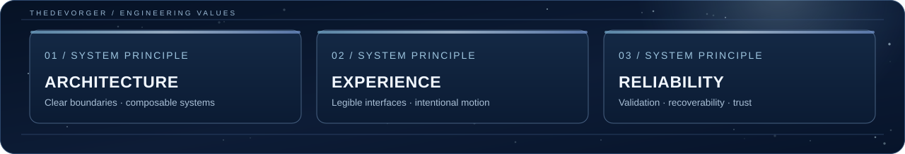
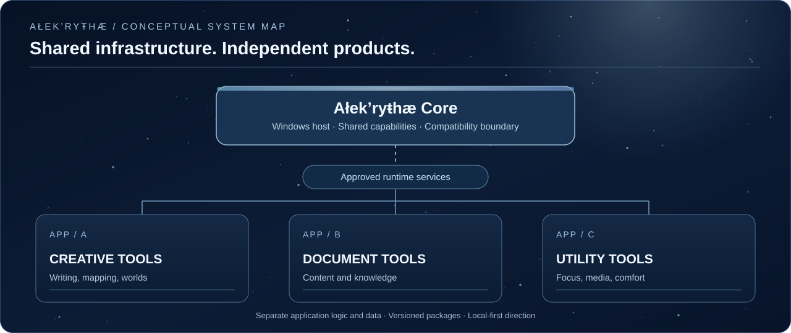

<!--
  TheDEvorger | Engineering portfolio / GitHub profile README
  Pure Markdown + GitHub-supported HTML. No embedded scripts, trackers,
  external badge providers, automation workflows, or executable snippets.
  Relative artwork is included in assets/readme/.
  Existing repository image Alekrythae.png remains unchanged.
-->

<div align="center">


<br />

# Ayberk Erdem · TheDEvorger

**Mechatronics Engineer · Software Developer · Independent Systems Builder**

Building purposeful Windows software, thoughtful interfaces, local-first tools,

and an evolving family of applications around **Ałek’ryŧhæ**.

<br />

**`C# / .NET`** &nbsp; **`JavaScript / TypeScript`** &nbsp; **`WebView2`** &nbsp; **`SQLite`** &nbsp; **`Flutter / Dart`**

<br />

[**Explore the systems**](#the-alekrythae-ecosystem) &nbsp;·&nbsp;
[**Featured work**](#featured-work) &nbsp;·&nbsp;
[**Engineering approach**](#engineering-approach) &nbsp;·&nbsp;
[**Get in touch**](#connect)

<br />

*Open to suitable international opportunities and selected software collaborations.*

</div>

---

<div align="center">

### DESIGN WITH INTENT. BUILD WITH DISCIPLINE.



<sub>Software should be understandable beneath the interface, predictable in operation, and worth using.</sub>

</div>

## At a Glance

I approach software from two directions: the practical discipline of engineering,
and the attention to atmosphere, interaction, and detail that gives a product its identity.
My background in mechatronics informs how I think about state, interfaces, failure modes,
feedback, maintainability, and real-world constraints.

Today my independent work concentrates on desktop application architecture,
Windows integration, UI engineering, local persistence, application packaging,
and modular product design. I also explore web and cross-platform development.

| Focus | What it means in my work |
| :--- | :--- |
| **Desktop engineering** | C#/.NET hosts, Windows application behaviour, integration boundaries, UI hosting |
| **Interactive product development** | JavaScript/TypeScript, React where appropriate, HTML/CSS, careful interaction design |
| **Local-first systems** | SQLite, JSON, file-oriented workflows, recoverable user data and explicit ownership |
| **Runtime architecture** | Shared infrastructure, independently versioned applications, compatibility contracts |
| **Product thinking** | Coherent visual identity, useful defaults, documented decisions, sustainable evolution |
| **Cross-platform learning** | Flutter/Dart for applications that reach beyond the Windows desktop |

> **My central design preference:** complexity belongs behind clear boundaries, not in the user's way.

### What you'll find here

- **A shared application platform:** the Ałek’ryŧhæ Core and its intended `.alek` application model.
- **Real project work:** desktop runtime development and local-first creative tooling.
- **Product concepts and ongoing builds:** an evolving catalogue, with maturity clearly distinguished.
- **Engineering rationale:** architecture, validation, storage, compatibility, and distribution practices.
- **A design language:** atmospheric and distinctive interfaces, without sacrificing clarity.

> **Project status convention:** *Public repository* means a repository can be visited now. *In development* means implementation is evolving. *Planned* refers to intended capabilities rather than delivered functionality. A publicly viewable repository is not automatically a production-ready release.

---

## Featured Work

### 01 · Ałek’ryŧhæ Core

**A shared Windows application runtime and host.**

[Explore the public repository](https://github.com/TheDEvorger/Alekrythae-Core)

`Public repository` · `C#` · `.NET` · `WebView2` · `Windows`

The Core is the technical centre of Ałek’ryŧhæ: a shared host intended to provide
common runtime services to applications packaged for the ecosystem.
Rather than repeatedly rebuilding window management, infrastructure, integration,
and storage behaviour inside every product, the architecture gives those concerns
a common home while allowing each application to retain its own identity.

**Engineering themes**

- Windows host and interface integration.
- Application-level service boundaries.
- Controlled interaction between application code and runtime capabilities.
- File and structured-data services.
- Version-aware application hosting and compatibility.
- Defensive thinking around file access and input validation.
- Compatibility-oriented tests and iterative refactoring.

**Why the design matters:** a shared runtime can reduce duplicated code,
but it also creates coupling. Compatibility guarantees, failure isolation,
and sensible separation of responsibilities must therefore be treated as first-class concerns.

**Maturity note:** the public repository is evidence of active engineering work.
Individual capabilities should be evaluated against its current source, tests,
and releases rather than inferred from this portfolio.

### 02 · Ałek’ryŧhæ WorldBuilder · FaeraTh

**A local-first creative workspace for writing, lore, maps, and world-building.**

[Explore the public repository](https://github.com/TheDEvorger/Alekrythae-WorldBuilder-FaeraTh)

`Public repository` · `JavaScript` · `Local-first` · `Creative tooling`

FaeraTh brings several related creative activities into one product direction:
world notes, narrative writing, geographical thinking, structured lore,
focus tools, and a workspace that stays close to the creator's own files.

**Product themes**

- Writing and lore organisation.
- Navigable world and location information.
- 2D cartography and visual world-building.
- Structured creative workspaces.
- Focus and productivity utilities.
- AI-assisted workflows where explicitly supported by the product.
- Alignment with the broader Ałek’ryŧhæ platform direction.

**The design challenge:** creative software must accommodate unpredictable workflows
without turning the interface into an obstacle course.
The aim is an expressive workspace with understandable organisation,
clear controls, and restrained use of visual effects.

**Maturity note:** consult the repository for the current implemented feature set;
these themes describe the product and its development direction.

### 03 · JOA FRP Writer / Obsidian Integration

**An independently developed writing and campaign-management experience.**

`In development` · `TypeScript / JavaScript` · `Obsidian` · `Local data`

A focused experiment in combining prose, structured entities, and game-master tools
without making narrative writing dependent on a remote service.
The design explores how a lightweight, fast-access panel can enrich existing Markdown
workflows while preserving the host application's role as the writing environment.

**Design goals**

- Rapid access to characters, NPCs, locations, objectives, and assets.
- Narrative text remains in Markdown; structured records use an appropriate data layer.
- Context-sensitive entity editing without disrupting the writing flow.
- Convenient local campaign clocks and reference tools.
- Flexible interface states designed around real writing sessions.
- Modular implementation that remains maintainable as the feature set grows.

**Engineering interest:** extension boundaries, event-driven UI,
state consistency, small interactions, and separating primary content
from structured supporting data.

*Project visibility and availability may differ from the two public repositories above.*

### The distinction that matters

My portfolio contains both **code you can inspect** and **products being designed or developed**.
I intentionally avoid presenting a roadmap as if it were a release history.
For exact implementation details, the corresponding repository is the source of truth.

---

<a id="the-alekrythae-ecosystem"></a>

## The Ałek’ryŧhæ Ecosystem

<div align="center">

### ONE CORE. MANY `.alek` APPLICATIONS.



<sub>Conceptual system model. It illustrates responsibilities and boundaries, not a claim that every capability is already shipped.</sub>

</div>

**Ałek’ryŧhæ** is an independent software ecosystem built around a shared Windows
runtime named **Ałek’ryŧhæ Core** and a family of separately identifiable applications.
The custom **`.alek`** package concept represents an application unit intended
to be understood, validated, and hosted by a compatible Core.

The architectural direction separates two kinds of responsibility:

| The shared Core | Each individual application |
| :--- | :--- |
| Runtime and hosting | Purpose and workflows |
| Common window and integration services | Product-specific interface |
| Approved data and file service boundaries | Application data model |
| Common lifecycle conventions | Features and interaction rules |
| Package and compatibility handling | Resources, configuration, and assets |
| Foundational validation controls | Product-level behaviour and validation |
| Cross-version infrastructure | Application-specific version history |

The intention is **reuse without uniformity**. A world-building workspace,
a slideshow tool, and a productivity timer need not resemble one another.
They can still benefit from shared infrastructure and consistent integration rules.

### The relationship in one picture

```text
                          AŁEK’RYŦHÆ
                      Independent ecosystem
                                 │
                   ┌─────────────▼─────────────┐
                   │       Ałek’ryŧhæ Core     │
                   │   Windows runtime / host  │
                   └─────────────┬─────────────┘
                                 │
                       Approved Core services
                                 │
           ┌─────────────────────┼─────────────────────┐
           │                     │                     │
    ┌──────▼──────┐       ┌──────▼──────┐       ┌──────▼──────┐
    │ Application │       │ Application │       │ Application │
    │   A.alek    │       │   B.alek    │       │   C.alek    │
    │ Own model   │       │ Own model   │       │ Own model   │
    │ Own UI      │       │ Own UI      │       │ Own UI      │
    └─────────────┘       └─────────────┘       └─────────────┘
```

**Not one executable pretending to be many products.**
The Core and applications have distinct roles, versioning needs,
and responsibilities. A `.alek` package is intended to identify an application,
not merely serve as a renamed ordinary document.

### Architecture goals

1. **Clear responsibility:** avoid application-specific behaviour leaking into platform code.
2. **Controlled capabilities:** make shared services explicit rather than granting arbitrary access by convention.
3. **Compatibility awareness:** allow Core and applications to evolve on separate timelines.
4. **Data ownership:** treat local projects as user-owned material, not disposable installation artifacts.
5. **Product independence:** retain unique interfaces and workflows behind common infrastructure.
6. **Fault containment:** prefer predictable failures, meaningful reporting, and recoverable state.
7. **Maintainability:** keep contracts stable enough to refactor implementation details responsibly.

### What `.alek` is intended to represent

A package may define metadata, identity, version requirements,
entry configuration, application logic, interface resources,
and associated data or migration information, depending on the product.
The exact package contract is implementation-defined and subject to evolution.

It is useful to separate **format**, **runtime**, and **application**:

- The **format** identifies the structure and compatibility expectations of a package.
- The **runtime** determines how compatible packages are prepared, hosted, and serviced.
- The **application** defines what the user is actually trying to accomplish.

This separation is a design direction, not a promise that arbitrary third-party packages
can safely execute. Trust and validation requirements must be supported by implementation.

---

## Product Atlas

The projects below describe a software family in different stages of maturity.
They share a visual and architectural direction without pretending to share
identical development status.

| Product | Purpose | Current portrayal |
| :--- | :--- | :--- |
| **Ałek’ryŧhæ Core** | Shared Windows runtime and application host | Public engineering repository |
| **WorldBuilder · FaeraTh** | Local-first lore, writing, mapping, and creative tools | Public engineering repository |
| **JOA FRP Writer** | Campaign and narrative tools integrated with Obsidian | In development |
| **Meggy The DM Master** | Tabletop campaign preparation and world-management system | Product direction |
| **Ałek’ryŧhæ Tlaengor** | Document and knowledge workspace | Product direction |
| **Mavi Ay Ekran Filtresi** | Display comfort and adjustable screen experience | Product direction |
| **Ałek’ryŧhæ Slideshow** | Local media presentation and sequencing | Product direction |
| **Ałek’ryŧhæ Pomodoro** | Focus and break-cycle utility | Product direction |
| **VELARVIA** | Digital art and creative desktop experience | Early design exploration |

<details>
<summary><b>Explore the product atlas in more detail</b></summary>

### Meggy The DM Master

A tabletop role-playing companion envisioned for preparation, navigation,
organisation, and simulation across a persistent fictional world.

**Product questions**

- How should long-running campaigns represent characters, locations, and relationships?
- Which concepts belong in structured data, and which should remain free-form narrative?
- How can navigation support exploration without burying the user in menus?
- How do time, travel, and world state fit into a consistent system?
- Where should maps, notes, atmosphere, and media controls connect?

**Planned capability areas**

- Campaign and adventure organisation.
- Character and non-player-character references.
- Location and region records.
- Travel, time, and calendar systems.
- Music and ambience controls.
- Campaign-focused storage and retrieval.
- Map-related tools and world navigation.
- Simulation and structured world state.

### Ałek’ryŧhæ Tlaengor

A document and knowledge workspace intended to make mixed project material easier
to inspect, organise, compare, and use without imposing one rigid content format.

**Planned capability areas**

- Markdown, text, JSON, and structured document viewing.
- Navigation across project files and folders.
- Searching, filtering, and contextual access.
- Media-aware documentation spaces.
- Multi-document workflows and combined views.
- Local-first storage and workspace preferences.

**Key product tradeoff:** rich previews improve usability,
but document fidelity, predictable file operations, and clear persistence rules
remain essential.

### Mavi Ay Ekran Filtresi

A Windows-oriented display comfort concept focused on practical control
over a screen's visible behaviour.

**Planned capability areas**

- Screen temperature and dimming adjustments.
- Scheduled visual transitions.
- Monitor-specific preferences where technically supported.
- Explicit pause and full-screen behaviour.
- Rest reminders.
- User-configurable controls and transitions.

**Key product tradeoff:** attractive visual feedback must never obscure
the distinction between software overlays and actual hardware brightness control.

### Ałek’ryŧhæ Slideshow

A local media presentation concept that values clean playback,
keyboard-friendly control, and understandable sequencing.

**Planned capability areas**

- Ordered image playback.
- Large local collections.
- Music playlists and audio transitions.
- Full-screen presentation.
- Keyboard interaction.
- Clear behaviour when media files are missing or moved.

**Key product tradeoff:** the presentation should feel effortless,
while its handling of file ownership and path changes remains explicit.

### Ałek’ryŧhæ Pomodoro

A focus-session utility with a distinct visual atmosphere
and deliberately simple everyday interaction.

**Planned capability areas**

- Configurable focus and rest intervals.
- Session states and progress feedback.
- Local settings.
- Visual transitions.
- Session history and lightweight review.

**Key product tradeoff:** a focus tool should not become a distraction.

### VELARVIA

An early digital-art application exploration that combines a refined desktop shell,
custom window behaviour, and a carefully composed creative experience.

**Design exploration**

- Resizable and maximizable desktop windows.
- A custom, coherent title-bar treatment.
- Remembered window preferences where appropriate.
- A distinctive opening experience.
- Future creative tools organised around the task, not around decoration alone.

**Maturity:** concept and design investigation. No public release claim is made here.

</details>

---

## Engineering Approach

I value software that can survive its own next version.
The initial implementation matters, but so do the boundaries that make
a future feature, bug fix, or migration manageable.

### Five working principles

| Principle | Practical interpretation |
| :--- | :--- |
| **Make boundaries explicit** | Define ownership and interfaces before coupling unrelated features |
| **Keep data understandable** | Prefer documented representations and recoverable project structures |
| **Validate at the edge** | Treat paths, manifests, external content, and inputs as untrusted until checked |
| **Test observable behaviour** | Check compatibility and user-visible results, not just internal implementation details |
| **Design for evolution** | Version contracts, isolate concerns, and record important decisions |

### From mechatronics to software

Engineering systems require dependable state transitions,
predictable responses, error reporting, and awareness of real constraints.
Those expectations carry naturally into desktop development:

- A user interface is a control surface.
- An application service is an interface contract.
- Persistence is part of the product's reliability story.
- Unexpected input is not an exceptional possibility; it is a condition to design for.
- A feature is incomplete if its failure modes are incomprehensible.
- Validation is stronger when expected results are written down.

### Current focus

**Application architecture:** designing modular, well-bounded desktop systems.

**Windows software:** connecting managed code, host processes, and web-based interfaces.

**Data systems:** choosing between structured records and human-readable files.

**Compatibility:** planning how applications and shared infrastructure evolve independently.

**Security awareness:** reducing unnecessary privileges, validating file boundaries,
and handling untrusted packages or paths cautiously.

**Interface engineering:** matching technical complexity with an interface that remains navigable.

**Cross-platform growth:** continuing to develop Flutter/Dart capabilities
alongside my Windows-focused work.

---

## Technical Toolkit

The technologies below are part of my active work or learning path.
They are not a claim of equal experience or mastery in every listed tool.

| Area | Tools and technologies |
| :--- | :--- |
| **Primary development** | C#, .NET, JavaScript, HTML, CSS |
| **Frontend and typed JavaScript** | TypeScript, React |
| **Windows integration** | WebView2, Windows APIs and desktop hosting concepts |
| **Data** | SQLite, JSON, local files, Markdown-oriented workflows |
| **Cross-platform development** | Dart, Flutter |
| **Development workflow** | Git, GitHub, debugging, structured testing, documentation |
| **Engineering background** | Mechatronics, industrial software, automation systems, hardware/software interfaces |

### Technical interests

```text
Desktop Systems          ███████████████████  Primary focus
Application Architecture ███████████████████  Primary focus
Interaction Design       ██████████████████   Strong interest
Local Data & Storage     █████████████████    Active practice
Web UI Engineering       ████████████████     Active practice
Flutter / Dart           █████████████        Developing
Embedded / Electronics   ███████████          Continuing interest
```

*These bars are qualitative areas of attention, not proficiency scores or measured performance data.*

### A stack is a means, not the product

C# and .NET offer a foundation for Windows-hosted functionality.
Web technologies can provide a flexible interaction layer.
SQLite can serve structured local information.
Markdown can preserve human-editable narrative and documentation.
Flutter/Dart provides another path for mobile and desktop interfaces.

The meaningful question is not how many logos fit in a row.
It is whether the chosen technology makes a particular product
more dependable, more maintainable, and easier to use.

---
## Inside the Architecture

The deeper notes below explain the thinking behind the ecosystem.
They are **design and engineering notes**, not a public specification
for stable APIs, nor instructions to circumvent runtime controls.

<details>
<summary><b>01 / Runtime versus application responsibilities</b></summary>

### Shared runtime responsibilities

A common host is most useful when it owns recurring infrastructure concerns.
Candidate responsibility groups include:

- Application discovery and registration.
- Package metadata interpretation.
- Host lifecycle and window behaviour.
- Well-defined file and data services.
- Shared integration with the operating system.
- Resource resolution and common presentation facilities.
- Version awareness and diagnostic reporting.

An important distinction is **providing a service** versus
**owning an application's business logic**.
For example, a shared storage facility can provide access to persistent data
without interpreting a particular campaign's story, a slideshow's playlist,
or a focus timer's scheduling rules.

### Application responsibilities

Application-specific concerns remain closer to the application itself:

- The problem it solves.
- Its interaction model.
- Its data schema and business rules.
- Its visual identity.
- Its navigation structure.
- Product-level error messages and recovery flows.
- Its roadmap and release notes.

### Boundary rules worth defending

- Application-specific rules should not silently become Core assumptions.
- The host should avoid depending on private implementation details of one application.
- Shared services should have clear input and output expectations.
- Capability availability should be discoverable instead of guessed.
- Missing or unsupported capabilities should fail predictably.
- Runtime changes should not unexpectedly rewrite application-owned content.

### Why separate versioning?

A shared Core may change independently of an application.
A product may also iterate rapidly without requiring a new shared runtime
for every text change, icon adjustment, or business rule.

Separate versioning makes compatibility a documented relationship,
not an accident of building everything in one directory.

### Why not put everything in Core?

A large shared runtime can become harder to test and slower to evolve
if every product feature is placed inside it.
The goal is a **small, useful common foundation**, not centralisation for its own sake.

</details>

<details>
<summary><b>02 / Package format and compatibility thinking</b></summary>

### Package identity

An application unit needs enough information to answer:

- What application is this?
- Which version is being requested?
- Which Core versions and capabilities does it expect?
- What is its declared entry point?
- Which resources belong to it?
- What data or configuration may need migration?

### Manifest design

A conceptual manifest may carry application identity,
version metadata, compatibility requirements, declared capabilities,
and resource references.
The schema itself should be treated as a versioned contract.

**This README intentionally does not publish a copy-paste package manifest.**
The exact schema should come from maintained project documentation
when an implementation is ready to support it.

### A compatibility model

| Concern | Useful question |
| :--- | :--- |
| Core version | Can this host support the package's declared expectations? |
| Format version | Does the runtime understand the package container? |
| Required capabilities | Are the requested services available and supported? |
| Data schema | Can existing user data be read without silent corruption? |
| Migration | Is change required, and is there a safe recovery route? |
| Resources | Are required assets present and valid? |
| Failure handling | Is incompatibility explained clearly to the user? |

### Compatibility is an agreement

A version number alone does not prove compatibility.
Runtime behaviour, service contracts, stored data,
and application assumptions all contribute to whether a release works.

### Desirable release discipline

1. Define the compatibility assumptions.
2. Exercise the expected runtime behaviour.
3. Identify changes that require migration or an updated Core.
4. Publish tested combinations where releases exist.
5. Explain known limitations instead of concealing them.
6. Preserve the user's ability to recover their work.

### Avoiding misleading guarantees

A compatible manifest does not by itself establish that a package is safe.
Package authenticity, resource validation, permissions,
and execution boundaries are separate concerns requiring real controls.

</details>

<details>
<summary><b>03 / Local-first persistence and data ownership</b></summary>

### Local-first as a design choice

Local-first does not mean every application must be offline forever.
It means the product should not unnecessarily take control
of the user's work away from them.

I prefer systems where primary content has a predictable location,
where formats are chosen intentionally, and where normal product updates
do not depend on discarding valuable user-created material.

### Structured and unstructured data

**SQLite** is useful for relationships, records, search-oriented structures,
and state that benefits from transactions.

**Markdown and text files** are appropriate for authoring,
long-form documentation, narrative, and material people should be able to read
outside the original interface.

**JSON** is useful for portable configuration, exchange,
and explicit structured representations where its tradeoffs fit.

These technologies solve different problems.
Combining them well requires a clear ownership boundary.

### Questions to answer for each data category

- Is the data created by the user or shipped with the application?
- Is it authoritative or derived from another source?
- Is it safe to regenerate?
- Should users be able to edit it directly?
- Does it require transactional consistency?
- Will another version need to migrate it?
- Does it need to be backed up or exported?

### Data classes

| Class | Typical example | Design expectation |
| :--- | :--- | :--- |
| User content | Notes, stories, campaign data | Preserve and make recoverable |
| App configuration | Preferences and layouts | Version carefully, tolerate missing values |
| Derived data | Thumbnails, indexes, caches | Rebuild when possible |
| Runtime resources | Shipped images and assets | Keep separate from user material |
| Migration metadata | Schema and conversion state | Make transitions inspectable |

### Failure states are part of persistence design

A storage strategy should consider incomplete writes,
invalid content, unexpected termination, missing resources,
and the difference between a failed save and a successful one.

Specific backup or transactional guarantees belong in individual
project documentation and tests, not in a general portfolio promise.

</details>

<details>
<summary><b>04 / Security-minded architecture and defensive boundaries</b></summary>

### Security is an implementation property

A well-organised diagram cannot guarantee isolation.
A validation checklist is not proof that a runtime is hardened.
Those claims require concrete implementation, review, and testing.

My design priorities include:

- Minimise unnecessary capabilities.
- Treat externally supplied paths and packages as untrusted.
- Validate metadata before depending on it.
- Keep application-owned data logically separate.
- Avoid ambiguous filesystem operations.
- Prefer explicit service interfaces.
- Avoid silently expanding privilege across boundaries.
- Keep errors useful without disclosing sensitive information.

### Boundary awareness

The trust boundary between an application package and its host
is not the same as the boundary between a user and their own files.
Both require considered behaviour, but the protections differ.

A system should also distinguish:

- **Validation:** checking that data meets expected requirements.
- **Integrity:** knowing whether content has changed unexpectedly.
- **Authenticity:** knowing who produced or authorised content.
- **Isolation:** limiting how one component affects another.
- **Recovery:** making safe outcomes possible after a problem occurs.

These properties are related, but none is an automatic substitute for another.

### Public documentation policy

Portfolio materials should communicate principles and engineering decisions
without exposing credentials, tokens, local account identifiers,
private build infrastructure, sensitive test data, or unnecessary operational detail.

A detailed vulnerability report should follow the project's
[security disclosure policy](SECURITY.md), not a public discussion thread.

</details>

<details>
<summary><b>05 / Testing strategy and compatibility-oriented thinking</b></summary>

### Tests should protect behaviour

A refactor can preserve compilation while changing outcomes.
For shared infrastructure, this is especially costly because many products
may depend on the same subtle behaviour.

An effective test portfolio considers different kinds of evidence:

| Test type | What it seeks to establish |
| :--- | :--- |
| Contract testing | Expected inputs and outputs remain meaningful |
| Compatibility testing | Existing supported behaviour survives changes |
| Storage testing | Persisted data remains readable and consistent |
| Edge-case testing | Invalid input and unusual states have deliberate outcomes |
| Integration testing | Components cooperate across their public boundaries |
| Manual UX checks | The actual interaction remains usable and legible |
| Release verification | The packaged artifact matches its documented expectations |

### Tests are not badges

A passing test is evidence for the behaviour it exercises,
not evidence that the entire system is secure or defect-free.
A test suite should also be honest about skipped cases,
platform requirements, and known limitations.

### Core-specific questions

- Do old and new paths produce equivalent expected results?
- Can the runtime recover from invalid or incomplete information?
- Does one application's failure interfere with another's data?
- Do resource boundaries behave as designed?
- Are long or unusual file paths handled predictably?
- Does a version transition preserve data the user expects to keep?

These questions drive test design; they do not imply that every scenario
has already been verified in every public version.

</details>

<details>
<summary><b>06 / Interface systems and visual identity</b></summary>

### A visual identity is a design system

The Ałek’ryŧhæ direction uses deep blue,
moonlit contrast, restrained ornament, and an atmosphere
inspired by fantasy and carefully constructed digital environments.

But identity must serve comprehension.
A beautiful control whose meaning is unclear is not finished.

### Visual design priorities

- Make the purpose of each primary action apparent.
- Preserve legibility over decorative complexity.
- Give interaction states clear visual feedback.
- Keep spatial relationships consistent across a product.
- Let motion communicate state instead of merely attracting attention.
- Design empty, loading, and error states intentionally.
- Respect resizing and varied window dimensions.
- Avoid accidental layout collisions.

### Desktop-specific considerations

Custom window chrome introduces responsibility:
window dragging, resizing, maximising,
keyboard interaction, focus handling, and standard OS behaviour
must remain predictable.

Likewise, a web-based UI hosted inside desktop infrastructure
should feel coherent without hiding the platform's constraints.

### A product can be atmospheric and practical

My preferred direction combines distinctive presentation
with straightforward navigation, understandable storage,
and low-friction daily use.

</details>

---

## Release and Distribution Philosophy

I treat source code, application packages, and finished releases
as different artifacts with different expectations.

### Source is not necessarily an installer

A repository archive may contain source files,
build tools, tests, examples, or partially developed capabilities.
It should not be mistaken for a ready-to-run application merely
because GitHub makes it easy to download.

Where an official release exists, its release notes should identify
what was produced and the conditions under which it is expected to run.

### A useful release description should answer

1. What product and version is this?
2. Is the artifact a runtime, an application package, or source code?
3. Which operating systems and runtime versions are supported?
4. What dependencies or compatibility requirements exist?
5. What changed from the previous version?
6. Is a user-data migration necessary?
7. What is known not to work?
8. Where can the authentic artifact be obtained?
9. How can a user confirm package integrity if a checksum is provided?
10. Where should a bug or vulnerability be reported?

### Release information belongs with the release

The profile README is an introduction and a technical portfolio.
Per-version changelogs, download instructions, checksums,
and compatibility matrices should live beside the actual artifact.

That avoids turning a personal profile into a stale installation guide.

### Official sources

- [Ałek’ryŧhæ Core repository](https://github.com/TheDEvorger/Alekrythae-Core)
- [WorldBuilder · FaeraTh repository](https://github.com/TheDEvorger/Alekrythae-WorldBuilder-FaeraTh)
- [TheDEvorger GitHub profile](https://github.com/TheDEvorger)

Do not assume an unofficial repackage is authorised merely
because it uses the same name or visual assets.

---

## Quality, Maintenance, and Documentation

Engineering quality is an accumulation of small decisions.
A clean feature boundary today reduces tomorrow's integration cost.
A clear release note today saves someone else's troubleshooting time.
A real failure test today prevents a misleading success claim later.

### Documentation I value

| Document | Reason to keep it |
| :--- | :--- |
| README | Explain purpose, scope, constraints, and next steps |
| Architecture notes | Record boundaries and important design choices |
| Compatibility notes | Make supported combinations explicit |
| Changelog | Explain externally meaningful changes |
| Security policy | Provide a responsible reporting channel |
| License | Make rights and restrictions unambiguous |
| Test instructions | Allow results to be reproduced where practical |
| Migration guide | Protect people from surprises during version changes |

### Change-management habits

- Keep related changes focused where practical.
- Explain why a change exists, not only which files changed.
- Preserve a stable interpretation of existing data when possible.
- Prefer documented tradeoffs over unexplained workarounds.
- Review accidental dependencies between components.
- Use meaningful commit messages.
- Re-evaluate assumptions as a product grows.

### What I deliberately avoid in a portfolio

- Artificial performance claims without benchmarks.
- Fake download counts, stars, contributors, or code quality scores.
- Calling a concept "production-ready" without evidence.
- Treating an internal design intention as a public API guarantee.
- Claiming security certification based on a README or a test list.
- Embedding third-party tracking widgets just to decorate a profile.
- Exposing private environment details for the sake of appearing technical.

This portfolio is built to age gracefully rather than to chase a dashboard number.

---

## Development Trajectory

### Present: build strong foundations

My present emphasis is on completing coherent building blocks:
reliable desktop behaviour, local data services,
well-separated application logic, understandable interfaces,
and testable interactions.

### Next: turn foundations into everyday tools

The longer-term goal is a family of applications
that benefit from the same engineering lessons
without becoming dependent on one enormous codebase.

### Beyond the Windows desktop

I am also studying and practising Dart and Flutter
to expand into mobile and cross-platform application development.
My interest in electronics and hardware-aware software remains
part of how I evaluate opportunities and future projects.

### How I measure progress

Not by the number of names on a roadmap,
but by whether a product becomes more reliable, more usable,
and easier to improve without breaking what already works.

---

## Frequently Asked Questions

<details>
<summary><b>Is Ałek’ryŧhæ a single application?</b></summary>

No. It is the name of a broader software ecosystem.
The Core is intended to provide shared infrastructure,
while individual applications keep their own purpose and versioning.

</details>

<details>
<summary><b>Is a `.alek` file the same as a standalone executable?</b></summary>

Not in the intended architecture. A `.alek` application package
is designed around compatibility with the Ałek’ryŧhæ Core.
The package's exact contents and requirements depend on the maintained specification.

</details>

<details>
<summary><b>Can I run every project listed above today?</b></summary>

No such claim is made. Some repositories are public engineering projects;
other items are ongoing development or longer-term product directions.
Always consult the relevant repository and release information.

</details>

<details>
<summary><b>Does local-first mean that all products are completely offline?</b></summary>

Not necessarily. Local-first expresses a preference for data ownership,
recoverable files, and avoiding unnecessary dependence on remote services.
Actual network behaviour depends on the application and its documented features.

</details>

<details>
<summary><b>Are the public repositories open source?</b></summary>

Not necessarily. Public visibility does not by itself grant open-source rights.
The applicable license controls what may be used, modified, redistributed,
or deployed. See the licensing note below.

</details>

<details>
<summary><b>Where should a security issue be reported?</b></summary>

Use the private reporting instructions in [SECURITY.md](SECURITY.md).
Avoid publishing sensitive details in public issues or comments.

</details>

<details>
<summary><b>Are you interested in collaboration or international work?</b></summary>

Yes, for suitable opportunities involving software development,
Windows applications, product engineering, or related technical work.
See the contact links below.

</details>

---

## Licensing and Rights

**Publicly visible does not mean open-source.**

Unless a particular repository explicitly states otherwise,
Ałek’ryŧhæ materials are proprietary and source-available
only to the extent actually published.

The relevant materials are governed by the applicable repository's
license, including the **TheDEvorger Universal Proprietary Software License v1.3**
where that license has been applied.

The complete [LICENSE.md](LICENSE.md) governs rights and restrictions.
This profile's short description is not a replacement for the legal text.

Third-party libraries, tools, and resources retain their own licenses.
Availability of a dependency does not alter the terms of proprietary project materials.

### Security disclosure

Potential vulnerabilities should be reported privately through
[SECURITY.md](SECURITY.md).
The README does not contain confidential diagnostic data,
secret values, privileged access procedures, or private operational details.

---

## Connect

<div align="center">

**Interested in the code, the design decisions, or a potential collaboration?**

[**GitHub**](https://github.com/TheDEvorger) &nbsp;·&nbsp;
[**LinkedIn**](https://www.linkedin.com/in/ayberk-erdem/) &nbsp;·&nbsp;
[**Repositories**](https://github.com/TheDEvorger?tab=repositories) &nbsp;·&nbsp;
[**Security policy**](SECURITY.md)

<br />

**Independent engineering · Desktop experiences · Local-first thinking**


**One Core. Many `.alek` applications. A system built to evolve.**

<sub>© 2026 TheDEvorger. All rights reserved. Product names and protected materials remain subject to their respective licenses.</sub>

</div>
