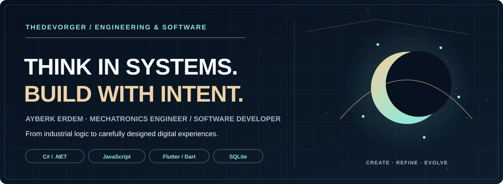
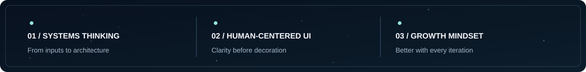
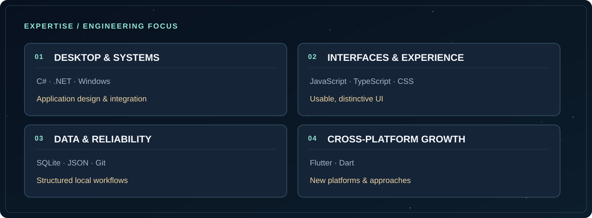
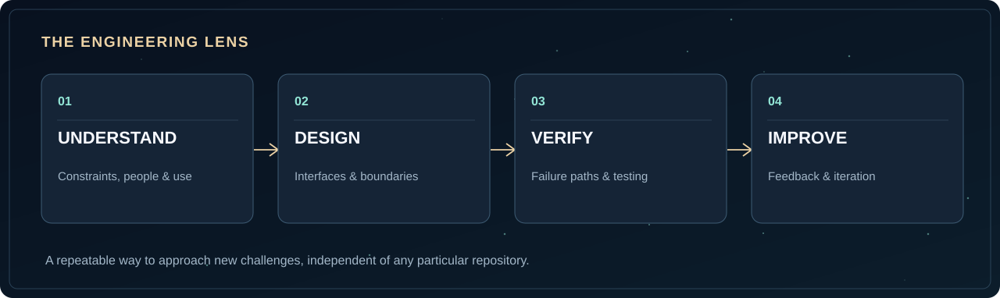

<!--
  TheDEvorger · Evergreen GitHub profile showroom
  Copyright (c) 2026 TheDEvorger. All rights reserved.
  Static local Markdown and self-contained SVG; no JavaScript, external trackers or dynamic counters.
  No specific projects are deliberately featured: the portfolio evolves, the introduction remains useful.
-->

<picture>
  <source media="(prefers-color-scheme: light)" srcset="assets/showroom/hero-light.svg" />
  
</picture>

 

### Ayberk Erdem · TheDEvorger

**Mechatronics Engineer** &nbsp;·&nbsp; **Software Developer** &nbsp;·&nbsp; **Curious Builder**

I turn engineering thinking into **thoughtful software**, with an interest in
**desktop applications**, **interface design**, **local data**, and **practical problem-solving**.

 

[**Explore my repositories ↗**](https://github.com/TheDEvorger?tab=repositories)
&nbsp;&nbsp;·&nbsp;&nbsp;
[**My expertise ↓**](#what-i-build-with)
&nbsp;&nbsp;·&nbsp;&nbsp;
[**Engineering mindset ↓**](#the-engineering-mindset)
&nbsp;&nbsp;·&nbsp;&nbsp;
[**Contact ↓**](#connect)

 

`C# / .NET` &nbsp; `JavaScript / TypeScript` &nbsp; `HTML / CSS` &nbsp; `SQLite` &nbsp; `Flutter / Dart`

**Open to international opportunities and software collaborations.**

---

<picture>
  <source media="(prefers-color-scheme: light)" srcset="assets/showroom/principles-light.svg" />
  
</picture>

## Welcome to my corner of engineering

My professional roots are in **mechatronics and industrial automation**: the world of
signals, systems, constraints, commissioning, and diagnosing what happens when
real equipment behaves differently from what the diagram promised.

That background shapes how I write software today. I care about what an interface communicates,
how data is handled, what happens when an operation fails, and whether the structure will still
make sense after the first successful demo.

I'm increasingly focused on software development, combining **Windows and desktop technologies**,
**web-based interfaces**, and an interest in **cross-platform application development**.
I also enjoy the design side: typography, interaction, atmosphere, and the tiny details that
make a tool feel intentional rather than assembled.

This is a **living portfolio**. The current work can be explored through the repositories,
while the interests and principles that connect it continue to evolve.

### Find your way around

| Explore | What you'll find |
| :--- | :--- |
| [**Repositories ↗**](https://github.com/TheDEvorger?tab=repositories) | The current, evolving collection of public work |
| [**What I build with**](#what-i-build-with) | Technologies, disciplines, and areas of focus |
| [**How I approach problems**](#the-engineering-mindset) | Architecture, reliability, and design priorities |
| [**My background**](#from-mechatronics-to-software) | Where the systems perspective comes from |
| [**Engineering notes**](#notes-from-the-workbench) | More detailed technical philosophy |
| [**Let's connect**](#connect) | Contact and professional opportunities |

---

## What I build with

<picture>
  <source media="(prefers-color-scheme: light)" srcset="assets/showroom/focus-light.svg" />
  
</picture>

A toolkit is a **set of choices**, not a personality test. I prefer selecting technology for the
problem at hand rather than making every new idea fit the same stack.

<table>
  <tr>
    <td width="50%" valign="top">
      <h3>🧩 Desktop & systems</h3>
      
<strong>C# · .NET · Windows · WebView2</strong>

      
Application lifecycle, system integration, native capabilities, clean boundaries, and maintainable desktop workflows.

    </td>
    <td width="50%" valign="top">
      <h3>✦ Interfaces & interaction</h3>
      
<strong>JavaScript · TypeScript · HTML · CSS · React</strong>

      
Responsive composition, meaningful feedback, usability, custom visual systems, and expressive application interfaces.

    </td>
  </tr>
  <tr>
    <td width="50%" valign="top">
      <h3>◇ Data & structure</h3>
      
<strong>SQLite · JSON · Local files · Git</strong>

      
Structured information, data ownership, persistence concepts, project organization, and careful handling of local resources.

    </td>
    <td width="50%" valign="top">
      <h3>↗ Cross-platform growth</h3>
      
<strong>Dart · Flutter</strong>

      
Continuing to build skills in mobile and cross-platform development while applying a systems-oriented approach to new platforms.

    </td>
  </tr>
</table>

### Technology map

| Area | Tools and working interests |
| :--- | :--- |
| **Languages** | C#, JavaScript, TypeScript, Dart, SQL, HTML, CSS |
| **Desktop** | .NET, WPF, Windows APIs, WebView2 |
| **Interface development** | Web UI, React, responsive layouts, interaction design |
| **Data and persistence** | SQLite, JSON, filesystem workflows |
| **Cross-platform (developing)** | Flutter, Dart |
| **Workflow** | Git, GitHub, VS Code, Visual Studio, debugging, documentation |
| **Engineering foundation** | PLC/SCADA, commissioning, industrial networks, system troubleshooting |

<strong>How these technologies fit together</strong>

A native desktop layer can provide integration with the operating system,
while web technologies can support complex, expressive interfaces.
Typed application logic can make important contracts clearer;
local storage can keep individual workflows lightweight and understandable.

I am interested in **appropriate architecture**, not adding layers simply because an
architecture diagram looks impressive. Some applications need very little infrastructure.
Others benefit from more deliberate separation between UI, state, domain logic,
and operating-system access.

**Experience levels vary across this toolkit.** Flutter/Dart remains an area of active learning,
and technology names here do not imply expert-level mastery or certifications.

---

## The engineering mindset

<picture>
  <source media="(prefers-color-scheme: light)" srcset="assets/showroom/process-light.svg" />
  
</picture>

I enjoy the point where engineering rigor meets a polished user experience.
Good software should look considered, behave predictably, and respect the person using it.

<table>
  <tr>
    <td width="50%" valign="top">
      <h3>01 / Architecture with purpose</h3>
      
Small, understandable responsibilities. Clear contracts. Choosing the simplest useful structure instead of chasing fashionable complexity.

    </td>
    <td width="50%" valign="top">
      <h3>02 / Design that communicates</h3>
      
Readable hierarchy, coherent navigation, useful feedback, thoughtful accessibility, and distinctive aesthetics without sacrificing usability.

    </td>
  </tr>
  <tr>
    <td width="50%" valign="top">
      <h3>03 / Data that belongs to the user</h3>
      
Local-first approaches where appropriate; sensible storage boundaries; attention to recovery, portability, and the effects of updates.

    </td>
    <td width="50%" valign="top">
      <h3>04 / Reliability over theater</h3>
      
Validation, testing, debugging, meaningful errors, and honest documentation. Real guarantees require evidence, not decorative badges.

    </td>
  </tr>
</table>

> **Build thoughtfully. Verify what matters. Keep improving.**
>
> A finished-looking interface is only the beginning of a dependable product.

---

## A portfolio that can grow with me

My repositories are an evolving record of exploration, learning and practical development.
To see the most current work, browse the public repositories directly.

### ✧ The current work lives on GitHub

[**Browse all public repositories ↗**](https://github.com/TheDEvorger?tab=repositories)
&nbsp;&nbsp;·&nbsp;&nbsp;
[**View recent activity ↗**](https://github.com/TheDEvorger)

Individual repositories contain their own setup notes, implementation details, release status, and licenses.

A public repository may be a learning exercise, prototype, utility, active product,
or a maintained tool. Its visibility does not automatically mean it is ready for production
or that its source is licensed for unrestricted reuse.

---

## From mechatronics to software

My background started with systems that connect **hardware, logic, and human operation**.
Industrial automation gave me hands-on experience with troubleshooting, commissioning,
and understanding how small assumptions affect real processes.

Today that same habit of asking *"what actually happens when this state changes?"*
is useful in application development, whether the issue is UI feedback, a file operation,
a database update, or a boundary between components.

| Engineering experience | Perspective carried into software |
| :--- | :--- |
| Commissioning and I/O verification | Thinking in observable behavior and acceptance checks |
| PLC logic and industrial interfaces | State, events, guard conditions and operator feedback |
| Field troubleshooting | Reproduce, isolate, measure, then change |
| Process and equipment integration | Understand dependencies and lifecycle constraints |
| Technical documentation | Make decisions and limitations understandable |

**My direction:** strengthen the software-development side of this foundation while
keeping the discipline and curiosity learned from real-world engineering.

---

## Notes from the workbench

The sections below are the technical ideas I keep returning to. They're **working principles**,
not a claim that every public repository implements every practice perfectly.

<strong>◇ System architecture and boundaries</strong>

### Start with responsibilities

I look for clear answers to a few basic questions:

- Who owns this state?
- Where does a behavior belong?
- What is the minimum contract between components?
- What happens if one component becomes unavailable?
- What assumptions cross the UI, application, persistence, and platform boundaries?

### Prefer explainable structure

An architecture is useful when it lowers the cost of understanding, changing, and testing a system.
Abstraction should remove repeated complexity, not bury the important parts behind layers of ceremony.

When native and web layers interact, **the boundary should be explicit**.
A convenient bridge is not automatically a security boundary; available capabilities
must be constrained by actual implementation and threat modeling.

<strong>◇ Security-conscious development</strong>

Security depends on context and verified controls, not on slogans. Important habits include:

- Treat untrusted input as untrusted, regardless of where it comes from.
- Validate file paths and avoid unintended access beyond the permitted scope.
- Keep secrets, access tokens, and private user data out of public repositories.
- Think about permission boundaries for OS integrations and embedded web content.
- Update dependencies deliberately and read security advisories.
- Document the difference between implemented safeguards and future intentions.
- Report and handle potentially sensitive vulnerabilities responsibly.

**A security policy is a communication channel, not a certification.**
There is no credible promise that a README, a repository, or a software system has
"zero vulnerabilities" merely because certain checks pass.

<strong>◇ Data ownership, migration and failure handling</strong>

For local applications, storage design is also product design. Questions worth answering:

- Where does user-created content live?
- Can it be exported or backed up?
- Can a partially failed operation be recovered?
- Are application files separated from personal projects?
- What changes between versions of the data format?
- How are Unicode names, long paths, missing files and interrupted writes handled?

Not every application needs a relational database.
When SQLite is appropriate, transactions and clear schema rules can help;
for other workloads, simple files may be the better choice.

<strong>◇ UI craft, accessibility and restraint</strong>

Visual identity matters to me, but a strong visual system should help users focus.
I look for accessible contrast, spacing, responsive behavior, readable typography,
keyboard interaction, and understandable states.

Decorative effects should not obscure content or become performance problems.
When a user can work more confidently because the interface is clear,
design has done its job.

The goal is not simply "more beautiful". It is **more coherent and more useful**.

<strong>◇ Testing, documentation and releases</strong>

As an application grows, I want to keep asking:

1. Which expected behaviors can be verified automatically?
2. Which conditions deserve explicit error handling?
3. What could break when a dependency changes?
4. Can the reported problem be reproduced reliably?
5. Are installation and update instructions accurate for the current build?
6. Does the release package exclude developer-only data?
7. Do release notes separate shipped functionality from work in progress?
8. Does the documentation communicate limitations as clearly as features?

I value reproducible results more than ceremonial test counts.
A useful test must prove something relevant about actual behavior.

<strong>◇ Learning across disciplines</strong>

Software, mechatronics, visual design, and language learning reward similar habits:
observe carefully, practice deliberately, verify understanding, then iterate.

I want to keep improving my software architecture, application design,
testing, cross-platform development, and communication in international teams.
Growth is not a one-time credential; it is the cumulative effect of better work.

---

## Beyond the code

I like software that has a distinct character without sacrificing engineering clarity.
I am drawn to interfaces with a strong visual atmosphere, workflows that reduce friction,
and tools that feel calm and intentional rather than noisy.

The interesting part is translating an idea into a system people can actually use:
choosing what matters, removing what distracts, and refining the interaction until
it becomes natural. That's the kind of craft I want to keep developing.

---

## Let's connect

<picture>
  <source media="(prefers-color-scheme: light)" srcset="assets/showroom/closing-light.svg" />
  
</picture>

 

**International opportunities** &nbsp;·&nbsp; **Software engineering** &nbsp;·&nbsp; **Thoughtful collaboration**

[**GitHub ↗**](https://github.com/TheDEvorger)
&nbsp;&nbsp;·&nbsp;&nbsp;
[**LinkedIn ↗**](https://www.linkedin.com/in/ayberk-erdem/)
&nbsp;&nbsp;·&nbsp;&nbsp;
[**Email ↗**](mailto:ayberkerdem.dev@gmail.com)

For licensing and legal inquiries:
[thedevorger.alekrythae.dev@gmail.com](mailto:thedevorger.alekrythae.dev@gmail.com)

---

<strong>Portfolio, licensing and responsible use</strong>

This profile is a **personal portfolio and engineering introduction**.
It is not a software license, a guarantee of product fitness, or an independent audit.

Source code visibility does not necessarily grant permission to use, redistribute,
modify, or commercialize it. Check the actual license and notices in each repository.
Third-party libraries and assets remain subject to their respective terms.

This profile's graphics are original, self-contained SVGs, served locally from the profile repository.
They do not use outside fonts, live counters, analytics images, third-party badges,
JavaScript, or workflow automation. These properties limit external presentation dependencies;
they do not by themselves make a development environment or an application secure.

THEDEVORGER  ·  ENGINEERING MINDSET  ·  CONSTANT EVOLUTION

© 2026 TheDEvorger. All rights reserved.

